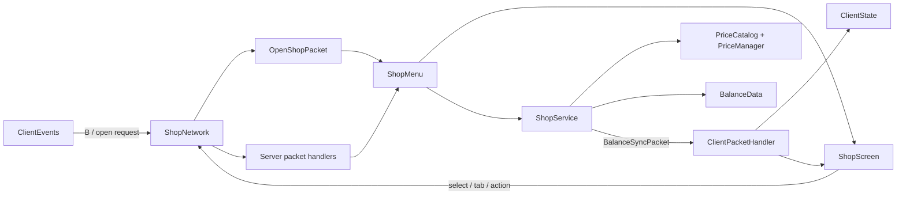

# Items Shop — карта репозитория

> [!abstract] Назначение
> Эта заметка хранит рабочий контекст репозитория: структуру, назначение файлов, архитектуру, инварианты, команды и принятые решения. Перед изменением проекта сначала читать эту карту, затем открывать только затрагиваемые файлы. Код остаётся источником истины при расхождении с картой.

## Быстрый контекст

| Параметр | Значение |
|---|---|
| Проект | Items Shop |
| Mod ID | `items_shop` |
| Java package | `ru.stas.itemsshop` |
| Текущая версия мода | `1.6.13` |
| Текущая реализация | `forge-1.20.1` |
| Minecraft | `1.20.1` |
| Forge | `47.4.10` |
| Java toolchain | `17` |
| Допустимый JDK для сборки | `17–21` |
| Network protocol | `4` |
| Лицензия | MIT |
| Основная ветка | `main` |

Items Shop добавляет сервер-авторитетный магазин почти всех ванильных предметов. Игрок продаёт добытые предметы, получает персональные монеты и покупает предметы через отдельную вкладку. Стартовый баланс — `0`.

> [!important] Правила работы
> - Каждая реализация хранится в каталоге `<modloader>-<minecraft-version>`.
> - Версия мода повышается только при изменении кода, ресурсов или поведения мода.
> - Изменения документации и структуры репозитория версию мода не повышают.
> - После согласованного изменения выполняются commit и push в `main`.
> - После изменения реализации обязательно запускать её сборку.
> - При добавлении, удалении или переименовании файлов обновлять эту карту.

## Навигация

- [[#Архитектура]]
- [[#Полный индекс файлов]]
- [[#Основные потоки выполнения]]
- [[#Сетевая модель]]
- [[#Экономика]]
- [[#Клиентский интерфейс]]
- [[#Совместимость]]
- [[#Сборка и проверка]]
- [[#Инварианты и риски]]
- [[#История важных решений]]
- [[#Чек-лист изменения мода]]

## Архитектура



### Границы ответственности

| Слой | Ответственность |
|---|---|
| Bootstrap | Регистрация `MenuType` и сетевого канала |
| Client | Клавиша, экран, локальное отображение баланса и уведомлений |
| Menu | Серверное состояние контейнера, слоты, выдача покупки, возврат предмета продажи |
| Network | Сериализация запросов и проверка текущего контейнера/игрока |
| Economy | Расчёт цен, транзакции и сохранение баланса |
| Compatibility | Скрытие внешних UI-оверлеев в экране магазина |

## Полный индекс файлов

### Корень репозитория

| Файл | Назначение |
|---|---|
| [[.gitattributes]] | Правила окончаний строк для генерируемых ресурсов во всех реализациях |
| [[.gitignore]] | Исключает IDE, Gradle, build, run, логи и crash reports |
| [[.github/ISSUE_TEMPLATE/bug_report.yml|bug_report.yml]] | Универсальная форма баг-репорта: версия мода, Minecraft, загрузчик, окружение, шаги и логи |
| [[.github/ISSUE_TEMPLATE/config.yml|config.yml]] | Конфигурация GitHub Issue Templates |
| [[CONTRIBUTING]] | Правила баг-репортов, PR и экономических изменений |
| [[LICENSE.txt]] | MIT License, copyright `fearless11ss` |
| [[README]] | Публичное описание, установка, структура репозитория и сборка |
| [[REPOSITORY_MAP]] | Текущая Obsidian-карта и постоянный рабочий контекст |

### Реализация `forge-1.20.1`: сборка

| Файл | Назначение |
|---|---|
| [[forge-1.20.1/build.gradle|build.gradle]] | ForgeGradle, run-конфигурации, зависимости JEI/IPN, ресурсы, JAR и reobf |
| [[forge-1.20.1/gradle.properties|gradle.properties]] | Версии Minecraft/Forge/мода, mappings и metadata |
| [[forge-1.20.1/settings.gradle|settings.gradle]] | Репозитории Gradle plugins и Foojay toolchain resolver |
| [[forge-1.20.1/gradlew|gradlew]] | Gradle wrapper для Unix |
| [[forge-1.20.1/gradlew.bat|gradlew.bat]] | Gradle wrapper для Windows |
| [[forge-1.20.1/gradle/wrapper/gradle-wrapper.properties|gradle-wrapper.properties]] | Gradle `8.8` и параметры загрузки wrapper |
| [[forge-1.20.1/gradle/wrapper/gradle-wrapper.jar|gradle-wrapper.jar]] | Бинарный launcher Gradle wrapper |

### Bootstrap

| Файл | Назначение |
|---|---|
| [[forge-1.20.1/src/main/java/ru/stas/itemsshop/ItemsShop.java|ItemsShop.java]] | `@Mod`, `MOD_ID`, регистрация `SHOP_MENU`, запуск `ShopNetwork.register()` |

### Client

| Файл | Назначение |
|---|---|
| [[forge-1.20.1/src/main/java/ru/stas/itemsshop/client/ClientEvents.java|ClientEvents.java]] | Клавиша `B`, регистрация экрана, tooltip спавнера, IPN-совместимость через reflection |
| [[forge-1.20.1/src/main/java/ru/stas/itemsshop/client/ClientPacketHandler.java|ClientPacketHandler.java]] | Принимает `BalanceSyncPacket`, обновляет состояние и показывает сообщение |
| [[forge-1.20.1/src/main/java/ru/stas/itemsshop/client/ClientState.java|ClientState.java]] | Клиентская копия текущего баланса, всегда неотрицательная |
| [[forge-1.20.1/src/main/java/ru/stas/itemsshop/client/ShopScreen.java|ShopScreen.java]] | Полный UI магазина: вкладки, поиск, категории, сетка, количество, цены и уведомления |

### Economy

| Файл | Назначение |
|---|---|
| [[forge-1.20.1/src/main/java/ru/stas/itemsshop/economy/BalanceData.java|BalanceData.java]] | `SavedData` с балансами по UUID в данных Overworld |
| [[forge-1.20.1/src/main/java/ru/stas/itemsshop/economy/PriceCatalog.java|PriceCatalog.java]] | Рекурсивный расчёт цен по рецептам и кэш на `RecipeManager` |
| [[forge-1.20.1/src/main/java/ru/stas/itemsshop/economy/PriceManager.java|PriceManager.java]] | Ручные цены, fallback, ограничения, книги, зелья и каталог торговых позиций |
| [[forge-1.20.1/src/main/java/ru/stas/itemsshop/economy/ShopService.java|ShopService.java]] | Серверные покупка/продажа, списание/начисление и синхронизация клиента |

### Menu

| Файл | Назначение |
|---|---|
| [[forge-1.20.1/src/main/java/ru/stas/itemsshop/menu/ShopMenu.java|ShopMenu.java]] | Два служебных слота, инвентарь игрока, вкладки, покупка, продажа и shift-click |

### Network

| Файл | Направление | Назначение |
|---|---|---|
| [[forge-1.20.1/src/main/java/ru/stas/itemsshop/network/ShopNetwork.java|ShopNetwork.java]] | Оба | Канал `items_shop:main`, protocol `4`, регистрация и отправка пакетов |
| [[forge-1.20.1/src/main/java/ru/stas/itemsshop/network/OpenShopPacket.java|OpenShopPacket.java]] | C → S | Открывает серверный `ShopMenu` и синхронизирует баланс |
| [[forge-1.20.1/src/main/java/ru/stas/itemsshop/network/RequestBalancePacket.java|RequestBalancePacket.java]] | C → S | Запрашивает актуальный баланс |
| [[forge-1.20.1/src/main/java/ru/stas/itemsshop/network/SelectPurchasePacket.java|SelectPurchasePacket.java]] | C → S | Передаёт item ID, книгу/зелье и количество; сервер реконструирует предмет |
| [[forge-1.20.1/src/main/java/ru/stas/itemsshop/network/MenuActionPacket.java|MenuActionPacket.java]] | C → S | Подтверждает покупку или продажу |
| [[forge-1.20.1/src/main/java/ru/stas/itemsshop/network/SetShopTabPacket.java|SetShopTabPacket.java]] | C → S | Синхронизирует Buy/Sell вкладку |
| [[forge-1.20.1/src/main/java/ru/stas/itemsshop/network/BalanceSyncPacket.java|BalanceSyncPacket.java]] | S → C | Передаёт баланс, сообщение операции и success-флаг |

### Compatibility

| Файл | Назначение |
|---|---|
| [[forge-1.20.1/src/main/java/ru/stas/itemsshop/compat/jei/ItemsShopJeiPlugin.java|ItemsShopJeiPlugin.java]] | Регистрирует весь `ShopScreen` как GUI-область, скрывая JEI overlay |

### Resources

| Файл | Назначение |
|---|---|
| [[forge-1.20.1/src/main/resources/META-INF/mods.toml|mods.toml]] | Forge metadata и обязательные зависимости Minecraft/Forge |
| [[forge-1.20.1/src/main/resources/assets/items_shop/lang/en_us.json|en_us.json]] | Английская локализация UI, сообщений и tooltip |
| [[forge-1.20.1/src/main/resources/assets/items_shop/lang/ru_ru.json|ru_ru.json]] | Русская локализация UI, сообщений и tooltip |
| [[forge-1.20.1/src/main/resources/pack.mcmeta|pack.mcmeta]] | Metadata встроенного resource pack |

### Генерируемые и игнорируемые каталоги

| Путь | Содержимое |
|---|---|
| `forge-1.20.1/.gradle/` | Локальное состояние Gradle |
| `forge-1.20.1/build/` | Classes, обработанные ресурсы и готовые JAR |
| `forge-1.20.1/run/` | Рабочий каталог `runClient`/`runServer` |
| `forge-1.20.1/run-data/` | Вывод data generator |
| `.obsidian/` | Локальные настройки Obsidian vault; не коммитятся |
| `out/`, `.idea/`, `.vscode/` | IDE-артефакты |

## Основные потоки выполнения

### Запуск мода

1. `ItemsShop` регистрирует `SHOP_MENU`.
2. Common setup вызывает `ShopNetwork.register()`.
3. Client setup регистрирует `ShopScreen` и клавишу `B`.

### Открытие магазина

1. `ClientEvents` замечает нажатие `B` только при отсутствии другого экрана.
2. Клиент отправляет `OpenShopPacket`.
3. Сервер создаёт `ShopMenu` через `NetworkHooks.openScreen`.
4. `ShopService.sync()` отправляет текущий баланс.
5. Клиент создаёт `ShopScreen`, локально строит каталог и запрашивает баланс ещё раз.

### Покупка

1. Клиент выбирает запись и отправляет только ID предмета, вариант книги/зелья и количество.
2. `SelectPurchasePacket` принимает только namespace `minecraft`, реконструирует серверный `ItemStack` и валидирует вариант.
3. `ShopMenu.selectPurchase()` создаёт серверный preview.
4. `MenuActionPacket(buy=true)` вызывает `ShopMenu.buy()`.
5. `ShopService.chargePurchase()` заново проверяет предмет, количество, цену и баланс.
6. После успешного списания предмет автоматически добавляется в инвентарь; остаток падает рядом с игроком.
7. Preview остаётся выбранным для повторных покупок.

### Продажа

1. Игрок кладёт стек в `SALE_SLOT` на вкладке Sell.
2. `SaleSlot.mayPlace()` принимает только `PriceManager.isTradable()`.
3. `MenuActionPacket(buy=false)` вызывает `ShopMenu.sell()`.
4. Меню копирует и полностью удаляет предложенный стек.
5. `ShopService.creditSale()` рассчитывает цену, начисляет баланс и отправляет результат.
6. При закрытии меню непроданный стек возвращается в инвентарь или падает рядом.

### Сохранение баланса

- Файл данных мира: `items_shop_balances`.
- Хранилище берётся из `server.overworld().getDataStorage()`.
- Ключ игрока — UUID.
- Отрицательные суммы не списываются; переполнение deposit насыщается до `Long.MAX_VALUE`.

## Сетевая модель

> [!warning] Server authority
> Клиентские цены, баланс и готовый NBT предмета никогда не принимаются как источник истины. Сервер проверяет `containerId`, тип открытого меню, вкладку, item namespace, вариант, количество и собственную цену.

- Порядок регистрации пакетов определяет их ID.
- При изменении структуры пакета или порядка регистрации повышать `ShopNetwork.VERSION`.
- `SelectPurchasePacket` отдельно кодирует enchanted book и potion variant.
- Книги разрешены только с одним валидным ванильным enchantment.
- Зелья разрешены только с зарегистрированным ванильным potion ID и непустыми эффектами.

## Экономика

### Общая модель

- `PriceManager` содержит ручные buy/sell overrides и правила fallback.
- `PriceCatalog` индексирует рецепты по выходному предмету в стабильном порядке ID.
- Buy price выбирает минимальный рецепт, добавляет processing cost/markup и применяет progression floor.
- Sell price не может превышать стоимость ингредиентов самого дешёвого рецепта, что блокирует простые crafting loops.
- Максимальная расчётная цена — `10_000_000`.
- Обычный fallback sell — около `buy / 5`, но массовые материалы имеют отдельные низкие значения.
- Цена повреждаемого предмета масштабируется по оставшейся прочности, минимум `1`.
- Зачарования на экипировке добавляют `15%` от расчётной стоимости продажи соответствующих книг.
- Нет дневных лимитов, штрафов за фермы и diminishing returns.

### Важные ручные решения

| Предмет | Покупка | Продажа | Причина |
|---|---:|---:|---|
| Magma Block | 100 | 2 | Массово встречается в Basalt Deltas; рецепт из Magma Cream завышал продажу до 1216 |
| Magma Cream | 3 500 | 50 | Фармится с Magma Cubes, но высокая buy price защищает экономику зелий |
| Spawner | 10 000 000 | 2 000 000 | Покупается пустым, максимум по одному |
| Dragon Egg | — | — | Полностью исключён из-за vanilla portal duplication |

### Торгуемые варианты

- Только предметы namespace `minecraft`.
- Почти все ванильные предметы, кроме административных/технических из `UNTRADABLE_ITEMS`.
- Enchanted books: каждый допустимый уровень каждого ванильного enchantment.
- Potions: effect potions для `POTION`, `SPLASH_POTION`, `LINGERING_POTION`.
- Mundane, Thick, Awkward и другие зелья без эффекта не добавляются.
- Максимальное количество покупки — `min(64, maxStackSize)`, для Spawner — `1`.

> [!warning] Продажа NBT
> Продажа удаляет весь предложенный стек вместе с custom name, enchantments, содержимым контейнера и другим NBT. Перед продажей контейнеры нужно опустошать.

## Клиентский интерфейс

- Экран: `360 × 261`.
- Каталог: `9 × 5` ячеек, прокрутка по строкам.
- Вкладки: Buy (`0`) и Sell (`1`).
- Служебные слоты: purchase preview (`0`) и sale (`1`).
- Поиск: локализованное имя, registry ID и имя/ID enchantment.
- Категории основаны на ванильных Creative Mode tabs.
- Количество покупки циклически переключается `1 → 16 → max → 1` с учётом stack limit.
- Уведомление об операции показывается `4` секунды.
- Escape и повторное нажатие клавиши магазина закрывают экран.
- Пока search box сфокусирован, hotbar/inventory keybinds не передаются контейнеру.

## Совместимость

### Inventory Profiles Next

- `ShopScreen` помечен `@IPNIgnore` через compile-only API.
- После инициализации экрана reflection очищает оставшиеся IPN widgets.
- IPN необязателен; ошибки reflection/linkage игнорируются.

### Just Enough Items

- Compile-only JEI common API.
- `ItemsShopJeiPlugin` объявляет весь экран GUI region, скрывая item list, bookmarks и кнопки.
- JEI необязателен и не включается в JAR.

## Сборка и проверка

### Windows

```powershell
cd forge-1.20.1
$env:JAVA_HOME = 'C:\Program Files\Microsoft\jdk-17.0.21.21-hotspot'
$env:Path = "$env:JAVA_HOME\bin;$env:Path"
.\gradlew.bat --gradle-user-home C:\GradleItemsShop build
```

### Запуск dev-клиента

```powershell
cd forge-1.20.1
$env:JAVA_HOME = 'C:\Program Files\Microsoft\jdk-17.0.21.21-hotspot'
$env:Path = "$env:JAVA_HOME\bin;$env:Path"
.\gradlew.bat --gradle-user-home C:\GradleItemsShop runClient
```

### Артефакт

`forge-1.20.1/build/libs/items_shop-<version>.jar`

### Текущее состояние проверок

- Автоматических test sources пока нет (`test NO-SOURCE`).
- Основная проверка — полный `build`, затем ручной `runClient`.
- Последняя проверенная сборка после переноса каталога: **успешно, 2026-11-09**.
- Известны compile warnings о deprecated `ResourceLocation(String, String)` в `ShopNetwork` и `ItemsShopJeiPlugin`; сборку не блокируют.

## Инварианты и риски

> [!danger] Не ломать
> - Все денежные операции остаются сервер-авторитетными.
> - Нельзя доверять цене, количеству или NBT, полученным от клиента.
> - При неуспешной покупке баланс и инвентарь не меняются.
> - Предмет из sale slot не должен теряться при закрытии меню.
> - Балансы должны сохраняться при обновлении версии мода.
> - Не добавлять crafting/trading loops, генерирующие деньги из покупных ингредиентов.

### Технические риски

- Recipe-based pricing не знает о природной массовой генерации; таким предметам нужны ручные overrides.
- Клиент показывает цены из своего `RecipeManager`, но окончательная цена всегда серверная.
- `PriceCatalog` кэшируется в synchronized `WeakHashMap<RecipeManager, PriceCatalog>`.
- `stillValid()` у меню всегда возвращает `true`, потому что магазин не привязан к блоку/позиции.
- Покупка при полном инвентаре создаёт drop; это ожидаемое поведение.
- При добавлении нового packet field нужна совместимая encode/decode последовательность и повышение protocol version.
- При создании нового каталога реализации нужно синхронизировать общие правила поведения между загрузчиками.

## История важных решений

| Версия/дата | Решение |
|---|---|
| 1.6.6 | Первый публичный релиз: магазин, балансы, категории, книги, server authority |
| 1.6.7 | Dragon Egg исключён; исправлена рамка инвентаря |
| 1.6.9 | Исправлена совместимость IPN/JEI |
| 1.6.12 | Добавлены варианты зелий и автоматическая доставка покупки |
| 1.6.13 | Magma Block `100/2`, Magma Cream `3500/50` |
| 2026-11-09 | Репозиторий переведён на каталоги `<modloader>-<minecraft-version>` |

## Где менять конкретную функциональность

| Задача | Основные файлы |
|---|---|
| Цена или доступность предмета | `PriceManager.java`, при необходимости `PriceCatalog.java` |
| Правила транзакции | `ShopService.java`, `ShopMenu.java`, `BalanceData.java` |
| Новый вариант предмета | `PriceManager.java`, `SelectPurchasePacket.java`, `ShopNetwork.java`, `ShopScreen.java` |
| UI/раскладка/поиск | `ShopScreen.java`, оба lang JSON |
| Новое сообщение | `ShopService.java` или client handler, оба lang JSON |
| Новый packet | `ShopNetwork.java` и новый record в `network/`; проверить protocol version |
| Сохранение данных | `BalanceData.java` |
| IPN/JEI | `ClientEvents.java`, `ItemsShopJeiPlugin.java`, `build.gradle` |
| Metadata/версия | `gradle.properties`, `mods.toml`, `pack.mcmeta` |
| Новая Minecraft/loader реализация | Новый каталог `<modloader>-<minecraft-version>`, затем README и эта карта |

## Чек-лист изменения мода

- [ ] Определить затрагиваемую реализацию.
- [ ] Проверить server-authoritative границу.
- [ ] Для экономики проверить buy→craft/brew→sell loops и природную доступность.
- [ ] При изменении packet wire format повысить protocol version.
- [ ] Обновить английскую и русскую локализации вместе.
- [ ] Повысить patch-версию, если изменён код, ресурс или поведение мода.
- [ ] Не повышать версию для чистой документации/структуры репозитория.
- [ ] Выполнить полный `build` из каталога реализации.
- [ ] При UI/runtime изменениях проверить через `runClient`.
- [ ] Обновить эту карту при изменении структуры или инвариантов.
- [ ] Commit и push в `main`.

